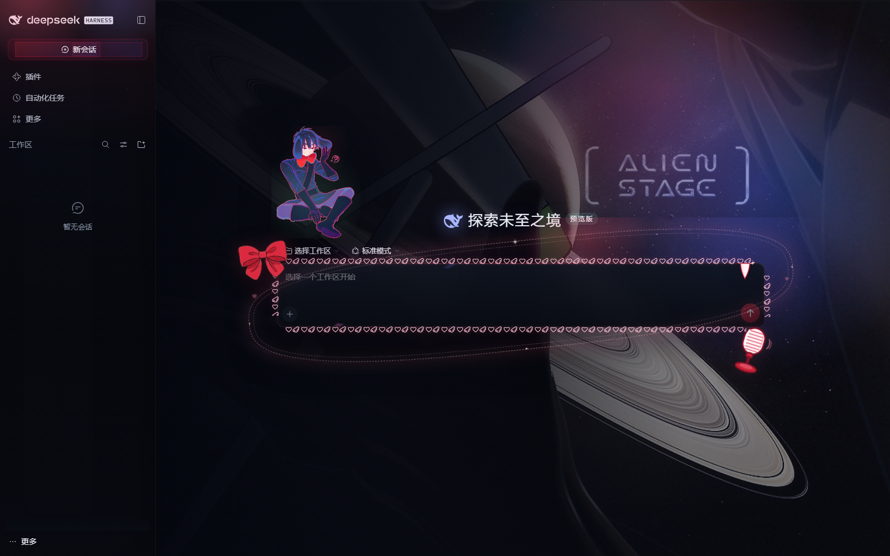
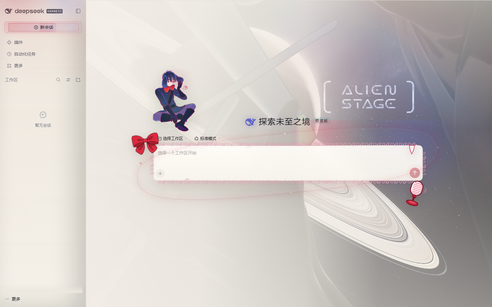
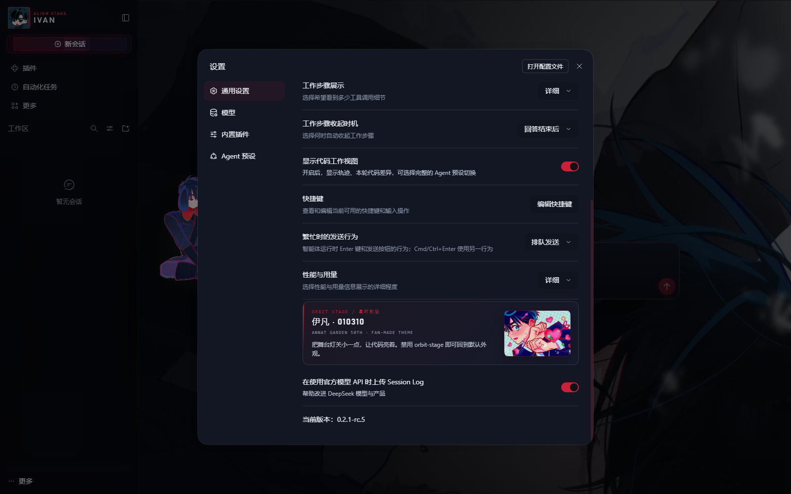

# ORBIT STAGE · 星环剧场

一个给 DeepSeek Harness Web GUI 的伊凡（《Alien Stage》/ IVAN · 010310）主题插件。







## 它做了什么

- **深空舞台**：深空黑底、星点、土星环弧线、左侧幕布红光。
- **首页主背景**：主题插画铺在首页主区域，左侧用深色渐变压住文字区；输入框保持原来的深色玻璃，不再加背景图。
- **品牌位保持原生**：侧边栏顶部继续使用 Harness 官方的鲸鱼标识与名称，不做替换；兔子耳朵在主页输入框的左上角上方，不占左右空间，窄窗口也会显示。
- **输入框舞台化**：首页输入框外圈用小爱心与天使翅膀的花边环绕，左上角系一枚正红色蝴蝶结（用提供的素材改色，不做重绘），右下角挂一支红色舞台话筒，右上角一颗小虎牙正好贴在边框上；再配椭圆星环与漂浮爱心。装饰全部为 `pointer-events: none`，不挡输入操作，并支持 `prefers-reduced-motion` 关闭动画。
- **舞台强调色**：幕布红用于主按钮、发送键、选中态；异星薄荷用于焦点环、链接、成功态；首页鲸鱼图标改为与插画同色系的蓝紫，不再用绿色。
- **玻璃表面**：输入框、菜单、弹窗、右侧栏使用半透明深色玻璃，长对话时自动加深阅读底色，不抢文字。
- **设置页彩蛋**：设置 → 通用最底部有一张 `ORBIT STAGE / 星环剧场` 小卡片，放粉红害羞那张图，不打扰主界面。
- **双主题**：深色是「舞台」，浅色是「后台」，跟随 Harness 现有的浅色 / 深色 / 系统设置。
- **不碰数据**：纯客户端插件，只覆盖主题 token 和一层 CSS；禁用插件即恢复原样。

## 已安装到哪里

已经写入当前桌面 profile：

- `C:\Users\28894\.dsh\profiles\desktop\package.json` 增加 `dsh-theme-orbit-stage` 依赖
- `C:\Users\28894\.dsh\profiles\desktop\cordis.patch.yml` 增加 `orbit-stage` 行

刷新 Harness 页面；如果主题没有出现，完全退出并重新打开 Harness（Host 需要重新组合 profile）。

桌面 profile 里安装的是这份包的副本，不是工作区链接；所以每次 `node build.mjs` 之后，还要运行 [`sync-to-desktop.ps1`](sync-to-desktop.ps1) 把新的 `lib/client.js` 覆盖过去，再重启 Harness。

## 使用

- 设置 → 通用 → 外观：切换 **深色 / 浅色 / 跟随系统**。
- 兔子现在锚在输入框左上角上方，不再依赖窗口宽度；如果觉得太高/太低，可以调 `src/theme.css` 里 `bottom: calc(100% + 44px)` 的数值。
- 首页主背景的明暗、位置在 `src/theme.css` 的 `[data-phase="hero"]` 规则里调。
- 主题本身没有额外开关；在插件管理里禁用 `orbit-stage` 即可临时关闭。
- 想换回官方外观：运行 [`uninstall.ps1`](uninstall.ps1)，然后重启 Harness。

## 开发

```powershell
# 修改 src/theme.css 或 src/tokens.mjs 后重新构建客户端 bundle
node build.mjs
```

构建会把 `assets/` 里的背景、头像、兔子贴纸、首页雪景和设置页彩蛋图全部内联进 `lib/client.js`（约 2.1 MB），所以运行时不依赖额外静态路由。

| 文件 | 作用 |
|---|---|
| [`src/theme.css`](src/theme.css) | 星环、玻璃、头像、品牌位、气泡、输入框等全部视觉层 |
| [`src/tokens.mjs`](src/tokens.mjs) | 深浅两套 `--dsw-*` 颜色 token |
| [`src/client.template.js`](src/client.template.js) | 浏览器半：注入背景层、样式和 token override |
| [`lib/client.js`](lib/client.js) | 构建产物（安装时实际加载的文件） |
| [`assets/backdrop-dark.png`](assets/backdrop-dark.png) | 深色星空 + 土星环背景 |
| [`assets/backdrop-light.png`](assets/backdrop-light.png) | 浅色后台背景 |
| [`assets/home-art.jpg`](assets/home-art.jpg) | 首页主区域星环背景（ALIEN STAGE 插画） |
| [`assets/bunny-cut2.png`](assets/bunny-cut2.png) | 主页输入框左侧的兔子贴纸 |

## 兼容性

当前针对 **DSH 0.2.1-rc.5** 的 DOM 类名（`mP3x-q_*`、`wtg9ga_*`、`an3WzG_*`、`GRgSLq_*`、`WOwLGG_*`）编写。DSH 升级后如果类名 hash 变化，星环和 token 仍会生效，但头像、品牌位、输入框玻璃等局部样式可能需要跟着更新选择器。

## 版权

- 这是个人自用的同人主题，不用于商业分发。
- 角色与原始插画版权归《Alien Stage》创作者 VIVINOS / QMENG 及原画作者所有。
- 主题代码（CSS / JS / 构建脚本）可自由修改自用；请勿把内嵌的官方/同人插画单独再分发。
