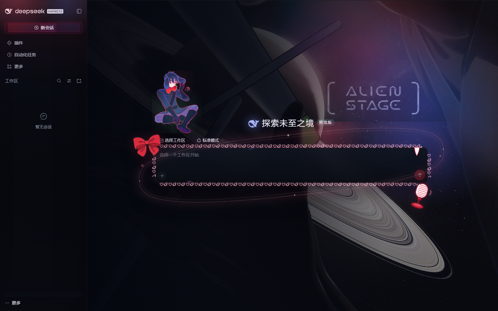

# ORBIT STAGE · 星环剧场 — 使用说明

> 一个给 **DeepSeek Harness** 桌面客户端的伊凡（《Alien Stage》/ IVAN · 010310）同人主题插件。
> 纯客户端插件：只覆盖颜色 token 和一层 CSS，不修改任何数据、路由或功能。



---

## 一、它包含什么

| 模块 | 效果 |
|---|---|
| 全局背景 | 深色为深空星点 + 土星环弧线 + 左侧幕布红光；浅色为安静的「后台」暖灰底 |
| 侧边栏 | 顶部红色光晕、碎星纹理、Ivan 壁纸淡影（默认 14% 透明度） |
| 首页 | 主区域铺 ALIEN STAGE 插画，左侧深色渐变压住文字区；输入框保持原生深色玻璃 |
| 主页输入框 | 外圈天使翅膀 + 小爱心花边、左上红蝴蝶结、右下舞台话筒、右上小虎牙、星环与漂浮爱心 |
| 新会话按钮 | 左上 / 右下各系一枚粉彩蝴蝶结角饰（骑在边框上，不占按钮内部空间） |
| 消息气泡 | 左下小人贴纸 + 右上小兽贴纸 + 四角星星点缀 |
| 设置页 | 「通用」最底部一张 ORBIT STAGE 小卡片彩蛋 |
| 强调色 | 幕布红用于主按钮、发送键、选中态；异星薄荷用于焦点环、链接、成功态 |
| 双主题 | 深色 = 舞台，浅色 = 后台，跟随 Harness 的「深色 / 浅色 / 跟随系统」 |

所有装饰都是 `pointer-events: none`，不挡点击；系统开启「减少动态效果」时动画会自动关闭。

---

## 二、运行环境

- **DeepSeek Harness** 桌面客户端，版本 **0.2.1-rc.5** 或更新。
- Windows（脚本为 PowerShell）。
- 只有「从源码重新构建」时才需要 Node.js 18+ 和 npm；仓库里已附带构建好的 `lib/client.js`，直接安装不需要 Node。

> 插件是本地 `file:` 包，不通过 npm 发布。

---

## 三、安装

### 1. 获取代码

```powershell
git clone https://github.com/770v0/dsh_ivan.git
cd dsh_ivan
```

仓库里已经包含构建产物 `lib/client.js`，可直接使用。如果你想改样式后重新构建：

```powershell
npm install      # 安装构建依赖（jimp）
node build.mjs   # 重新生成 lib/client.js
```

`build.mjs` 会把 `assets/` 里的所有图片以 base64 内联进 `lib/client.js`（约 4.6 MB），所以运行时不需要额外的图片文件。

### 2. 注册到桌面 profile

编辑 `C:\Users\<你的用户名>\.dsh\profiles\desktop\package.json`，在 `dependencies` 里加一行（路径改成你实际克隆到的位置，用正斜杠或双反斜杠）：

```json
"dsh-theme-orbit-stage": "file:D:/path/to/dsh_ivan"
```

改完后在该 profile 目录执行一次安装，让它把包放进 `node_modules`：

```powershell
cd $env:USERPROFILE\.dsh\profiles\desktop
npm install
```

### 3. 启用插件

编辑同目录下的 `cordis.patch.yml`，在文件末尾追加：

```yaml
# ORBIT STAGE — fan-made Ivan / Alien Stage skin (local client plugin).
- insert:
    - id: orbit-stage
      name: dsh-theme-orbit-stage
```

### 4. 重启 Harness

**完全退出** DeepSeek Harness（不是关窗口，要退出托盘/后台进程），再重新打开。插件是 Host 在启动时装载的，仅刷新页面不足以加载新插件。

---

## 四、验证与日常使用

- 打开后侧边栏应有红色顶部光晕与深空底色，首页主区域为插画背景。
- 外观切换：**设置 → 通用 → 外观**，在「深色 / 浅色 / 跟随系统」之间切换，两套配色都已适配。
- 临时关闭：在插件管理里禁用 `orbit-stage`，或在 `cordis.patch.yml` 中注释掉那段 `insert`，然后重启。

---

## 五、自定义

改动都集中在 `src/` 下，改完执行 `node build.mjs`，再运行 `sync-to-desktop.ps1` 覆盖桌面 profile 里的副本，最后完全重启 Harness。

> `npm install` 生成的是**副本**而非软链接，所以只重新构建工作区不会自动影响已安装的主题。

| 想调整 | 位置 |
|---|---|
| 全局背景明暗 | `src/theme.css` → `#orbit-stage-bg` 的 `opacity` |
| 侧边栏 Ivan 壁纸存在感 | `.orbit-stage-sidebar-art-img` 的 `opacity`（深浅两套各一处） |
| 首页主背景构图 / 明暗 | `src/theme.css` 里 `[data-phase="hero"]` 相关规则 |
| 新会话按钮蝴蝶结的位置与大小 | `[class~="wtg9ga_newSession"]::before / ::after` 的 `top`、`left`、`width`、`height` |
| 气泡贴纸的位置与大小 | `[data-message-bubble]::before / ::after` |
| 主页输入框兔子高度 | `src/theme.css` 里的 `bottom: calc(100% + 44px)` |
| 配色 / 文字层级 / 边框 | `src/tokens.mjs`（`pair(浅色, 深色)` 成对修改） |
| 首页与设置页插入的 DOM | `src/client.template.js` |

`sync-to-desktop.ps1` 会把 `lib/client.js` 复制到 `%USERPROFILE%\.dsh\profiles\desktop\node_modules\dsh-theme-orbit-stage\lib\client.js` 并校验哈希；若提示路径不存在，说明主题还没安装到该 profile，请先完成「安装」第 2 步。

---

## 六、更新与卸载

### 更新

```powershell
git pull
node build.mjs          # 若仓库更新了源码，重新构建
.\sync-to-desktop.ps1
```

然后完全重启 Harness。

### 临时停用

运行仓库里的 `uninstall.ps1`：它会从 `cordis.patch.yml` 移除 `orbit-stage` 装载行，并备份为 `cordis.patch.yml.orbit-stage.bak`。包本身保留，想恢复时把那段 `insert` 加回去即可。

### 彻底卸载

1. 执行 `uninstall.ps1`（或手动删掉 `cordis.patch.yml` 里的 `insert` 段）。
2. 从 profile 的 `package.json` 删除 `dsh-theme-orbit-stage` 依赖。
3. 删除 `%USERPROFILE%\.dsh\profiles\desktop\node_modules\dsh-theme-orbit-stage`。
4. 完全重启 Harness，界面即恢复官方外观。

---

## 七、常见问题

**Q：装好了但完全没有变化？**
确认 `cordis.patch.yml` 里 `insert` 段已添加、`node_modules\dsh-theme-orbit-stage\lib\client.js` 存在，并且是**完全重启**而不是刷新页面。

**Q：改了 CSS 却没生效？**
工作区改动不会自动同步到桌面 profile。需要 `node build.mjs` → `.\sync-to-desktop.ps1` → 完全重启。

**Q：Harness 升级后，某些装饰消失或样式错位？**
本主题依赖 Harness 内部 CSS Module 类名（`mP3x-q_*`、`wtg9ga_*`、`an3WzG_*`、`GRgSLq_*`）。升级后类名哈希可能变化，token 与全局背景通常仍生效，但依赖类名的局部装饰需要更新选择器。气泡已改用稳定的 `[data-message-bubble]` 属性；如果某次升级后气泡装饰不见，优先检查这个属性是否还在。

**Q：新会话按钮里出现多层方框？**
说明选择器用了子串匹配 `[class*="wtg9ga_newSession"]`，会把按钮内部的 `LabelMask / Content / Label / Shortcut` 子元素一起命中。本主题已改为 `[class~="wtg9ga_newSession"]`（精确 token）。自行修改时请保持 `~=`。

**Q：浅色主题下装饰太淡 / 深色下太黑？**
浅色与深色分别有独立的 `filter` 规则（`body:not([data-ds-dark-theme])` 前缀），只调对应那一条的 `saturate / contrast / brightness` 即可。

**Q：会不会影响正常使用或数据？**
不会。插件只注入一层 CSS、一组颜色 token 和若干 `pointer-events: none` 的装饰节点；禁用插件后全部移除。

---

## 八、文件结构

```
dsh_ivan/
├─ src/
│  ├─ theme.css           # 全部视觉层：星环、玻璃、品牌位、气泡、输入框装饰
│  ├─ tokens.mjs          # 深浅两套 --dsw-* 颜色 token
│  └─ client.template.js   # 浏览器半：注入背景、样式、token override 与装饰节点
├─ assets/                # 背景、贴纸、角饰等原始素材（构建时内联）
├─ lib/
│  ├─ client.js           # 构建产物（实际被 Harness 加载的文件）
│  └─ index.js            # 插件入口
├─ build.mjs              # 构建脚本（素材 → base64 → client.js）
├─ sync-to-desktop.ps1    # 把构建产物同步到桌面 profile
├─ uninstall.ps1          # 从 profile 移除装载行
├─ preview-*.png          # 预览图
└─ package.json
```

---

## 九、版权

- 这是个人自用的同人主题，不用于商业分发。
- 角色与原始插画版权归《Alien Stage》创作者 VIVINOS / QMENG 及原画作者所有。
- 主题代码（CSS / JS / 构建脚本）可自由修改自用；请勿把内嵌的官方 / 同人插画单独再分发。
